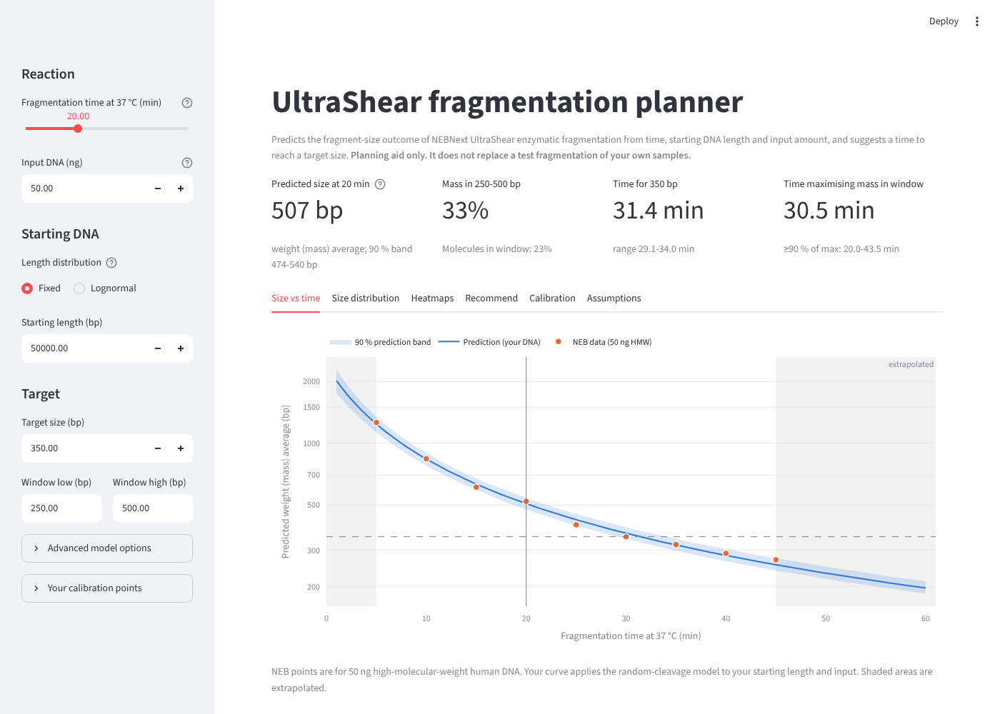
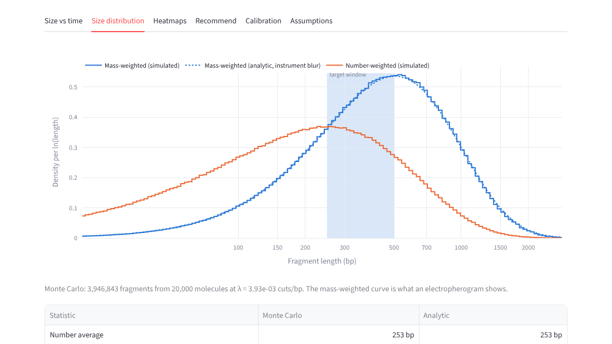

# ultrashear-sim

**Plan NEBNext® UltraShear® enzymatic DNA fragmentation for any short-read WGS library.**
Given a fragmentation time, the starting DNA length (or length distribution) and the input
amount, the tool predicts the fragment-size distribution. It also recommends the time needed to
reach a target size, or to put as much DNA as possible into a size window.

> **Planning aid, not a replacement for a test fragmentation.** The only calibration data are
> NEB's time course for 50 ng of high-molecular-weight human DNA. Everything else comes from a
> first-principles random-cleavage model and is flagged as such. Use the tool to narrow the time
> range, then confirm with a small calibration run on your own samples.



**Live app: <https://hung-wgs-fragmentation.streamlit.app/>** (it may take ~30 s to wake up if
nobody has used it recently). To run it locally instead:

```bash
git clone https://github.com/hung-th/wgs-fragmentation.git
cd wgs-fragmentation
pip install -e ".[app]"
streamlit run app/streamlit_app.py
```

## What it does

* **Size vs time** for your DNA, with a 90 % prediction band, the NEB points and a reference HMW
  curve overlaid.
* **Fragment-size distribution** (mass- and number-weighted, Monte Carlo plus analytic) with
  your target window shaded, and the fraction of mass and of molecules inside it.
* **Heatmaps** of predicted size over time × starting length, and over time × input. The input
  map is captioned as assumption-driven.
* **Recommendations**: the time (and range) to reach a target size, or to maximise the fraction
  in a window, with a note on whether the answer lies inside the calibrated 5-45 min range.
* **Warnings** for extrapolated times, input outside the validated 5-250 ng range, and starting
  DNA far below HMW.
* **Calibration mode**: enter or upload your own (time, size[, start length, input]) points and
  refit, then see how far the prediction moved. You can also upload an electropherogram trace
  to fit the shape of the size distribution.
* **Downloads**: predictions (CSV), all settings and parameters (JSON), and plots (interactive
  HTML; PNG via the camera icon on each chart).
* **Quick explainer**: the *How length and input affect fragmentation* button under the title
  summarises the two sections below.



## What is calibrated and what is assumed

| Component | Status |
|---|---|
| Size vs time, ~50 ng HMW DNA, 5-45 min | **Calibrated**: NEB data, 9 points |
| Effect of starting DNA length | **Model prediction** (random cleavage, `1/L_n = λ + 1/L0`); not validated by data |
| Effect of input amount | **Assumption**: `t_eff = t·(50/m)^α`, default `α = 0` (no effect); the NEB manual validates 5-250 ng and states no size effect |
| Width/shape of the distribution (gamma shape `k`) | **Assumption**: `k = 1` (Poisson) unless fitted from your trace |
| Meaning of the measured "average size" | **Choice**: default mass-weighted (TapeStation region average); number average or peak selectable |
| Times < 5 or > 45 min | **Extrapolation** |

**Calibration quality** (default settings): every NEB point is reproduced within **5.9 %**, with
leave-one-out RMSE **4.4 %**. The selected cut-density model is `λ(t) = a + b·t`, chosen by AICc
over linear, power-law and saturating forms. See [`docs/model.md`](docs/model.md) for the
equations, model comparison and limitations.

## How starting length and input amount matter

**Starting length.** Fragment size follows the cut density: `1/size ≈ λ(t) + 1/L0`. Above about
50 kb the `1/L0` term is negligible, so 50 kb, 1 Mb and 40 Mb DNA all give the same result:

| Time (min) | 50 kb | 1 Mb | 40 Mb |
|---|---|---|---|
| 10 | 836 bp | 843 bp | 843 bp |
| 30 | 364 bp | 365 bp | 365 bp |
| Time to reach 350 bp | 31.4 min | 31.5 min | 31.5 min |

Starting length matters only below about 10 kb. There, molecule ends make the fragments shorter,
so less time is needed (e.g. 3 kb DNA reaches about 725 bp at 10 min, against about 840 bp for
HMW DNA). Megabase DNA usually breaks into shorter pieces during handling anyway, which does not
change the prediction. The app accepts starting lengths up to 5 Mb, and anything above about
1 Mb behaves the same.

**Input amount.** The cutting rate per bp is set by the concentration of free enzyme, not by the
amount of DNA. With less DNA there are fewer cuts in total, but also fewer bp to cut, so the size
is the same. That is the default (`α = 0`). Less DNA fragments faster only if the DNA ties up a
large share of the enzyme (saturation). The `α` setting models this, and `α = 1` is the fully
saturated extreme. NEB uses one protocol across 5-250 ng, which suggests the effect is small.

Time to reach 350 bp (HMW DNA) for different assumed `α`:

| α | 10 ng | 50 ng | 200 ng |
|---|---|---|---|
| 0 (default) | 31 min | 31 min | 31 min |
| 0.25 | 21 min | 31 min | 44 min |
| 0.5 | 14 min | 31 min | 63 min |

**Check it yourself.** Fragment the same DNA at a low and a high input (e.g. 10 and 200 ng) for
the same time. If the sizes match, `α ≈ 0`. If the low input gives a smaller size, add both as
calibration points with their `input_ng` and raise `α` until they fit.

## Using your own calibration points

In the app, open **Your calibration points** in the sidebar and type the points in or upload a
CSV:

```csv
time_min,size_bp,start_length_bp,input_ng,label
10,780,20000,25,sample A
25,410,20000,25,sample A
```

`start_length_bp` and `input_ng` are optional. Blank means the calibration reference
(50 kb, 50 ng). Measure fragment sizes on the same instrument and with the same "average"
definition that the model is set to. From Python:

```python
from ultrashear.calibration import calibrate, load_neb_points
from ultrashear.io import read_points
from ultrashear.model import StartLength
from ultrashear.recommend import time_for_target_size
import pandas as pd

points = pd.concat([load_neb_points(), read_points("my_points.csv")], ignore_index=True)
cal = calibrate(points)
print(cal.summary_table())
print(time_for_target_size(cal, 350, StartLength(8_000, "lognormal", cv=0.7)).message)
```

**Suggested minimal calibration run:** fragment one HMW control DNA and two of your own samples
at two times that bracket the recommended time. Measure the starting length and the fragment
size on the same instrument, then add the points and refit.

## Repository layout

```
data/neb_calibration.csv   NEB time course (source note in file)
src/ultrashear/            model code (no Streamlit imports)
  model.py                 settings, constants, starting-length distribution
  analytic.py              closed-form renewal-process statistics
  calibration.py           lambda(t) fit, model selection, bootstrap
  simulate.py              vectorised Monte Carlo engine
  metrics.py               averages, N50, peak, fraction in window
  recommend.py             time for target size / best window fraction
  io.py                    user points, electropherogram traces, trace fit
app/streamlit_app.py       UI
tests/                     pytest suite (model, MC vs analytic, calibration, app smoke tests)
docs/model.md              equations, assumptions, limitations
```

Development: `pip install -e ".[dev]" && ruff check . && pytest`.

## Deployment

The live app runs on **Streamlit Community Cloud** from the `main` branch and updates
automatically on every push. To deploy your own copy (free): sign in at <https://share.streamlit.io>, choose
*Create app*, select this repository and branch, and set the main file to
`app/streamlit_app.py`. `requirements.txt` installs the package with its app extras. Free apps
go to sleep when idle and take ~30 s to wake.

A server-free build with [stlite](https://github.com/whitphx/stlite) (Streamlit in WebAssembly,
hosted on GitHub Pages) should be possible, because numpy, scipy, pandas and plotly are all
available in Pyodide. It has not been tested yet.

## Data source and citation

Calibration data are from New England Biolabs, *NEBNext UltraShear (NEB #M7634) Instruction
Manual*, Figure 1: 50 ng NA12878 DNA fragmented for 5-45 min at 37 °C, then 15 min at 65 °C,
sized on an Agilent TapeStation D5000 HS ScreenTape. Cite NEB when reusing these values.
NEBNext® and UltraShear® are trademarks of New England Biolabs. This project is independent and
is not affiliated with or endorsed by NEB.

## Licence

MIT. See [LICENSE](LICENSE).
